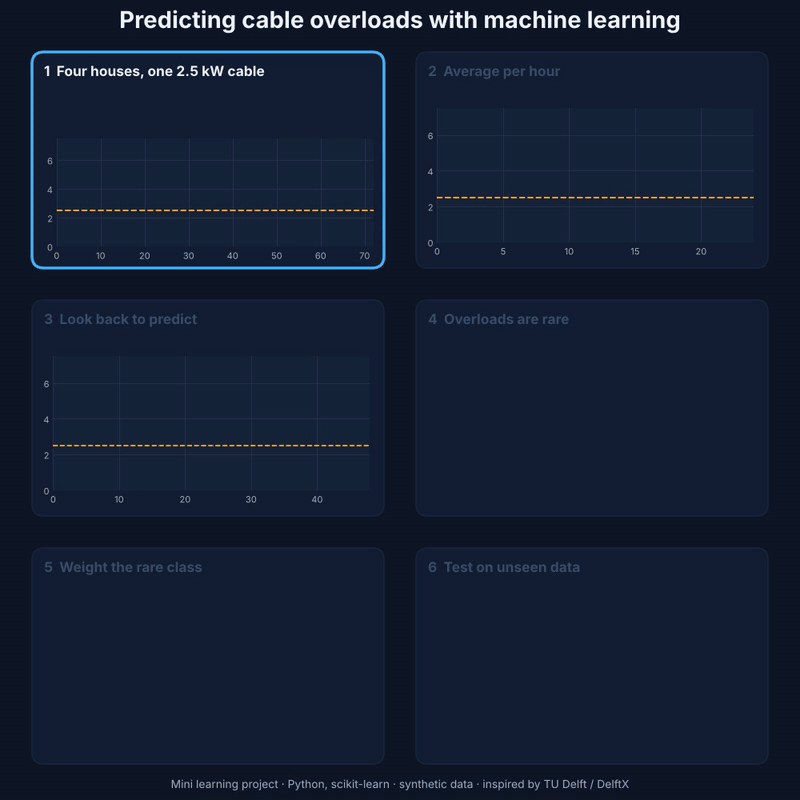
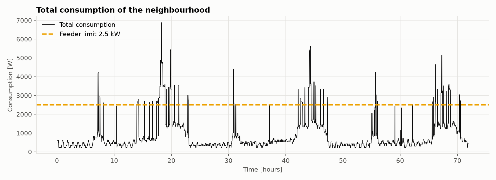
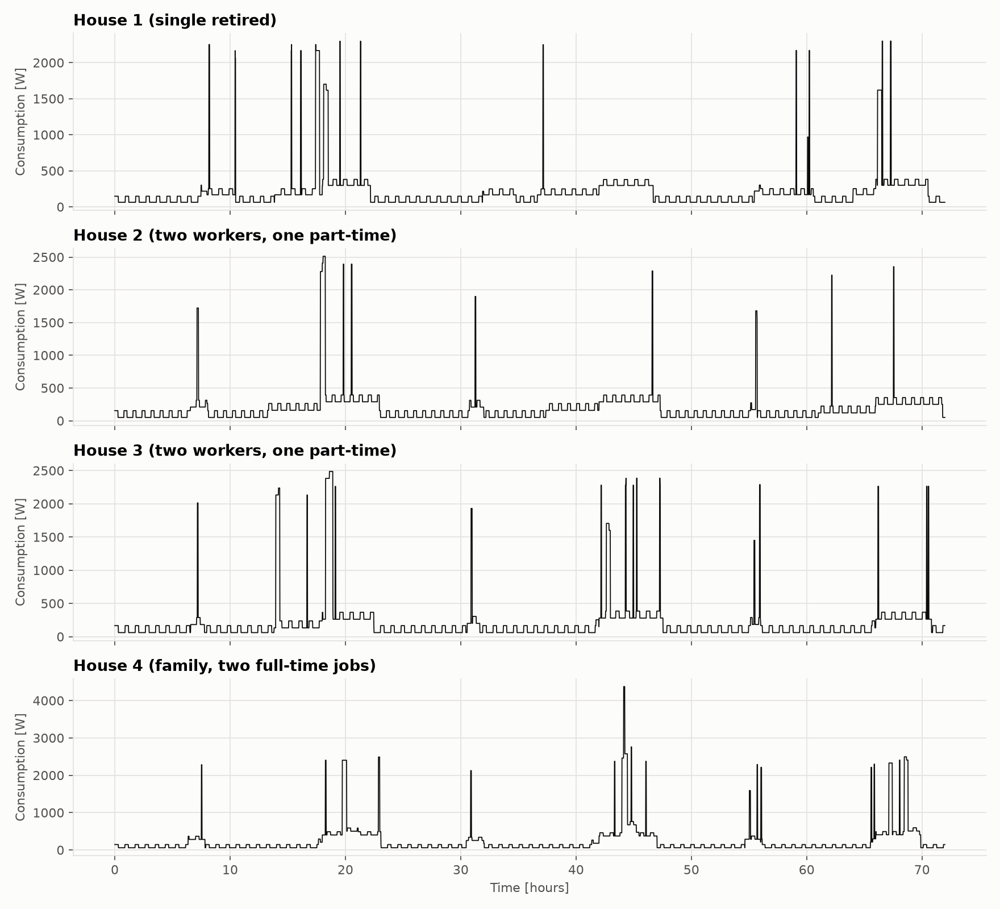
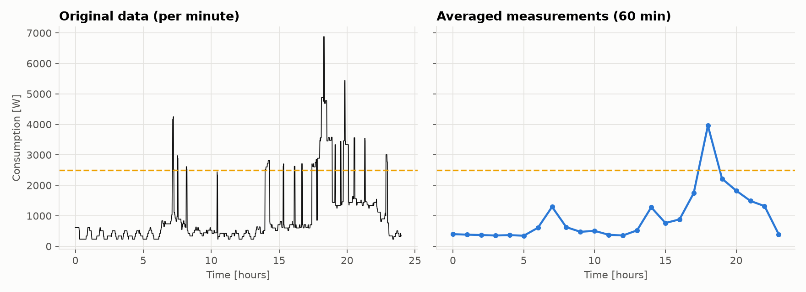
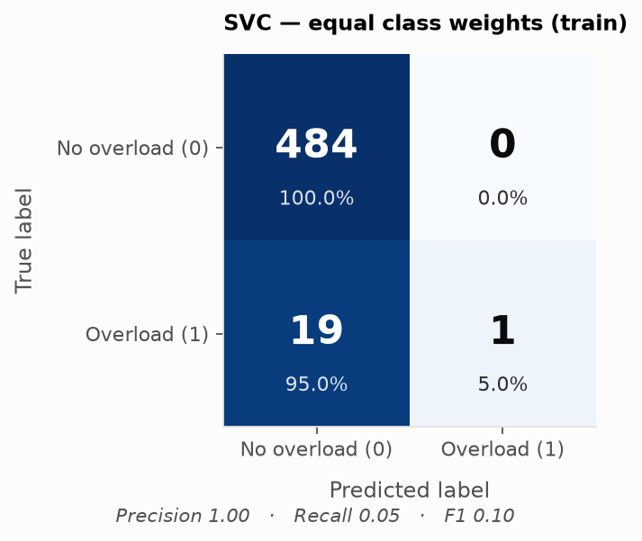
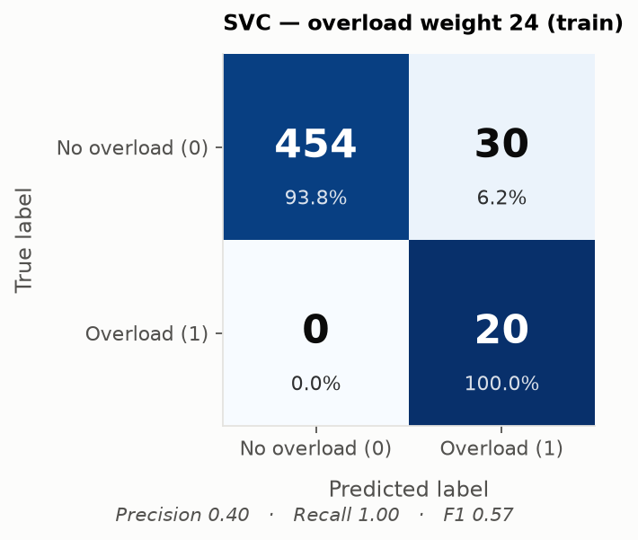
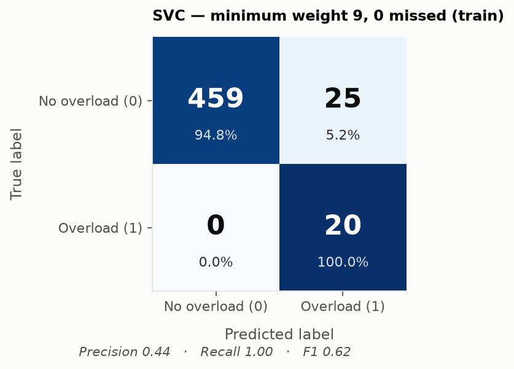
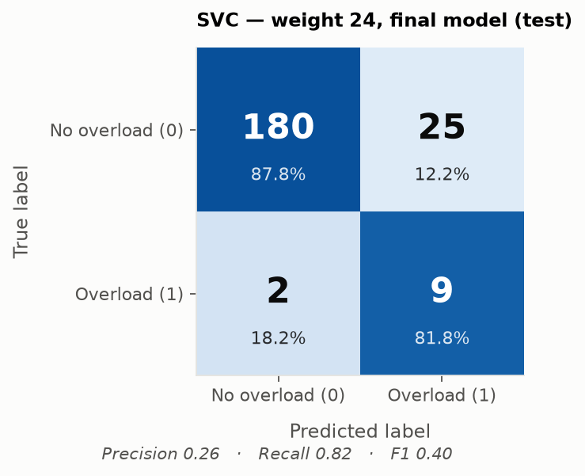

# Predicting Cable Overloading with Machine Learning (Python, scikit-learn)

A small neighbourhood of four houses is connected to the grid through one cable (feeder) with a
safe capacity of **2.5 kW**. If the houses together use more, the cable is overloaded and a switch
has to disconnect it. The goal of this project is to **predict an overload before it happens**,
using only past measurements, with a machine-learning classifier: a support vector machine (SVM).

The project follows the steps of the machine-learning exercise in the TU Delft / DelftX course
*Digitalization of Intelligent and Integrated Energy Systems*. I wrote all the code myself and
ran it on my own synthetic household data.





---

## The data

Four houses, one value per minute for 31 days (44,640 rows), in watts:

| House | Inhabitants |
|---|---|
| House 1 | single retired person |
| House 2 | two working people, one part-time |
| House 3 | two working people, one part-time |
| House 4 | family, both parents with full-time jobs |

**The data is synthetic.** I generated it with my own behaviour-based generator
(`src/overload_prediction/load_generator.py`): who is at home and awake, always-on loads (standby, a cycling fridge),
lighting and electronics, and appliance events that cause short, high peaks (kettle, microwave,
cooking, hair dryer, washing machine, dishwasher, iron, vacuum cleaner). A fixed random seed makes
it reproducible. It is not measured data. The approach is inspired by bottom-up generators such as
the ALPG (University of Twente), but no ALPG code or data is used.

---

## Step by step

### Step 1: Inspect the household profiles


Every house follows a daily rhythm. A low base load at night comes from standby devices and the
fridge switching on and off. Activity in the morning and especially the evening raises the load,
and short spikes of 2–4.7 kW come from appliances. The retired person uses energy spread over the
day. The working households and the family use most in the morning and evening.

### Step 2: Sum the houses and compare with the feeder limit
The total load often goes above 2.5 kW, mostly in short evening spikes. Why not just cut the load
when that happens? Because in real time **the future is unknown**: by the time the measurement shows
an overload, it is already happening. The overload has to be **predicted** from earlier
measurements.

### Step 3: Hourly averages, features and labels


* The four houses are summed (no individual house data is needed, which also protects privacy) and
  averaged per **60 minutes**.
* **Features:** for every hour t, the average load **1, 2, 3, 4 and 24 hours before**.
* **Label:** 1 if the average load in hour t is above 2.5 kW (overload), otherwise 0.

This gives **720 samples** (31 days minus the first 24 hours). Only **31 of them (4.3 %) are
overloads**, so the data is very **imbalanced**.

### Step 4: Split into training and test data (70/30)
`test_size=0.3` gives 504 training samples (20 overloads) and 216 test samples (11 overloads).
Together they add up to 720 again, so the split works.

### Steps 5 – 8: Confusion matrices

<table>
<tr>
  <td align="center"><b>Step 5</b> — SVC, equal weights (train)<br></td>
  <td align="center"><b>Step 6</b> — SVC, overload weight 24 (train)<br></td>
</tr>
<tr>
  <td align="center"><b>Step 7</b> — lowest weight, no missed overloads (train)<br></td>
  <td align="center"><b>Step 8</b> — SVC weight 24 on test data<br></td>
</tr>
</table>

| Model | Unbalanced acc. | Balanced acc. | Precision | Recall |
|---|---:|---:|---:|---:|
| SVC, weights 1/1 (train) | 0.962 | 0.525 | 1.000 | **0.050** |
| SVC, overload weight 24 (train) | 0.940 | **0.969** | 0.400 | **1.000** |
| SVC, weight 9 — min without missed (train) | 0.950 | 0.974 | 0.444 | **1.000** |
| SVC, weight 24 — test data | 0.875 | 0.848 | 0.265 | 0.818 |

**Step 5** — equal weights → model finds only 1 of 20 overloads. High accuracy is misleading on
imbalanced data; recall is what matters here.

**Step 6** — weight 24 (ratio of normal to overload samples) → all 20 overloads found, at the cost
of 30 false alarms. For a safety switch, a false alarm is safer than a missed overload.

**Step 7** — sweeping weights 1–24 shows missed overloads first reach zero at **weight 9**, with
fewer false alarms than weight 24.

**Step 8** — on unseen test data the model still catches **9 of 11 overloads**. The small drop from
training to test is normal and shows the model generalises well.

On unseen data the model still catches **9 of 11 overloads**. Performance drops a little, which is
normal, but it is still good on both sets. So the model is **neither underfitted** (that would be bad
on both) **nor strongly overfitted** (that would be very good on training and bad on test).
The small drop shows it fits the training data slightly too closely. It still missed 2 overloads
and gives more false alarms on new data, so more data, especially more overload examples, would be
the next improvement: the model learned from only 20 overloads.

---

## Key takeaways
* **Accuracy alone is misleading on imbalanced data.** A model that misses almost every overload
  still scored 96 %. Balanced accuracy, recall and precision tell the real story.
* **Class weights fix the imbalance**, at the cost of more false alarms. For safety, recall matters most.
* **Tune just enough.** Weight 9 caught every training overload, just like weight 24, but with
  fewer false alarms.
* **Test on unseen data.** The model still catches 9 of 11 overloads on data it has never seen,
  so it generalises well, with only a small drop from training to test.
* **Averaging hides short spikes.** Hourly averages turn short appliance peaks into "overload
  hours", so the model predicts hours with a high average load, not every short spike.

---

## Run it yourself (VS Code)

```bash
git clone https://github.com/parthivmehta1812/cable-overload-prediction.git
cd cable-overload-prediction
python -m venv .venv
# Windows: .venv\Scripts\activate    macOS/Linux: source .venv/bin/activate
pip install -r requirements.txt
python run_study.py      # prints Steps 1-8 and saves figures, tables and data
```

```
cable-overload-prediction/
├── run_study.py                    # runs Steps 1-11 in order
├── src/overload_prediction/
│   ├── load_generator.py           # synthetic minute-level profiles for the four houses
│   ├── features.py                 # sum + average per interval, features, labels
│   ├── metrics.py                  # accuracy, balanced accuracy, precision, recall
│   └── plots.py                    # all figures
├── data/
│   └── Electricity_Profile.csv     # generated data (44,640 rows x 4 houses, W, separated by ;)
├── results/
│   ├── figures/                    # one figure per step
│   └── tables/                     # report.txt and the weight sweep table
├── requirements.txt
├── LICENSE
└── README.md
```

---

## Acknowledgements

The study design and its settings (2.5 kW feeder limit, hourly averaging, features 1, 2, 3, 4 and
24 hours back, 70/30 split, support vector classifier) come from the machine-learning
exercise of the TU Delft / DelftX course *Digitalization of Intelligent and Integrated Energy
Systems*. The code and the synthetic data are my own. No course notebooks, helper code or data are
included.

Author: Parthiv Mehta · [LinkedIn](https://www.linkedin.com/in/parthivmehta) · MIT License
